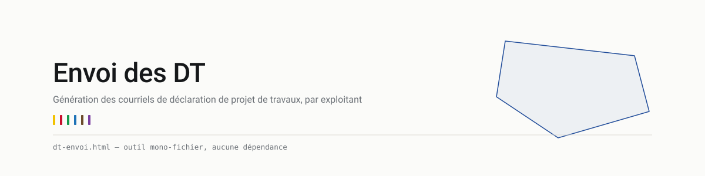

# Envoi des DT

Outil mono-fichier (HTML/JS, sans dépendance ni build) pour générer les courriels de déclaration de projet de travaux (DT/DICT) à partir d'une archive de dossier de consultation du guichet unique.

## Usage

`index.html` est une copie de `dt-envoi.html`, servie à la racine pour GitHub Pages. Les deux fichiers doivent rester identiques.

Ouvrir `dt-envoi.html` (ou `index.html`) dans un navigateur, déposer l'archive `.zip` du dossier. L'outil :

- lit le XML de description et les formulaires Cerfa embarqués (décompression zip/deflate en JS natif, aucune bibliothèque externe)
- rapproche chaque Cerfa avec son exploitant (société, agence, nom)
- affiche un tableau récapitulatif par exploitant (réseau, mode d'envoi, adresse)
- génère un `.eml` prêt à l'envoi par exploitant acceptant la dématérialisation (pièces jointes incluses), regroupés dans un zip téléchargeable
- signale les exploitants à traiter par courrier postal, avec une liste dédiée

Aucune persistance, aucun suivi après envoi : l'outil vérifie, génère, télécharge.
